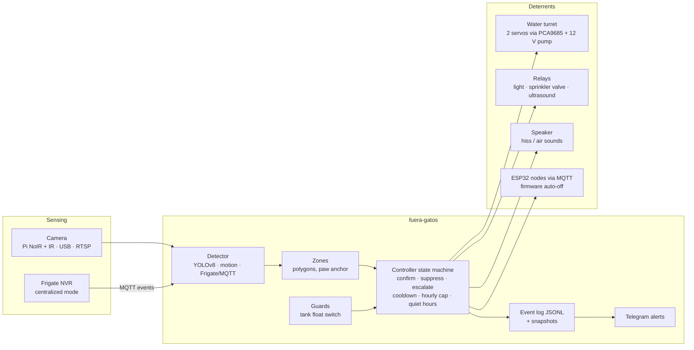

# fuera-gatos

[](https://github.com/ipenas-cl/fuera-gatos/actions/workflows/ci.yml)
 

*English · [Español](README.es.md)*

**A camera-based cat deterrent that scares cats away without hurting them.** A camera watches the problem
areas (trash bags, flower beds). A neural network (YOLOv8) or a motion detector recognizes the cat, and a
**pan/tilt water turret tracks it with a thin, low-flow jet** in short bursts, backed up by light, sound
and ultrasound. It is built for street cats that are already used to dogs, spikes and ultrasonic
repellents, so water is the baseline from the first visit.

It runs on a single Raspberry Pi per location, or in **centralized mode**: one home server running
Frigate and MQTT, PoE IP cameras outside, and ESP32 nodes that drive the relays and servos.

## Safety principles: scare, never harm

- **Surprise, not force.** A garden-gun or 12 V diaphragm-pump jet, never a pressure washer. Each activation lasts 4–6 s in bursts, with a hard per-device cap (`max_on_s`). The pump can't stay on.
- **Bounded aiming.** The turret has configurable mechanical limits, so even a wrong detection can't aim at the sidewalk or a neighbor's yard.
- **Confirmation.** Several detections inside a time window are needed before acting, so shadows and birds don't trigger anything.
- **People and dogs shut everything down.** If a `person` or `dog` is anywhere in the frame, nothing fires.
- **Cooldown and an hourly cap**, **quiet hours** (no audible sound at night), and **per-zone limits** (for example, no water on a shared roof).
- **Escalation.** A quick return (under 5 minutes) moves up to level 2. After a long absence it resets to level 1.
- **Resource guard.** A float switch blocks water deterrents when the tank is empty and sends an alert.

See [docs/humanitario.md](docs/humanitario.md) (in Spanish) for what is and isn't safe, plus passive measures.

## Architecture



### Hardware (single-Pi mode)

| Part | Purpose |
|---|---|
| Raspberry Pi 4/5 (2 GB is enough) | Runs detection |
| Pi Camera Module 3 **NoIR** + IR illuminator | Night vision, when cats show up most |
| 4-channel opto-isolated 5 V relay module | Pump, valve, light, ultrasound |
| 2 metal servos (MG996R) + PCA9685 + pan/tilt mount | Turret that follows the cat |
| 12 V diaphragm pump + 1.5–2 mm jet nozzle | Long, thin, low-flow jet |
| 12 V solenoid valve + impact sprinkler, LED floodlight, 3 W speaker + PAM8403, ultrasonic repellent | Level-2 backup and extra deterrents |
| IP65 enclosure | Weather protection |

A Pi Zero 2 W also works with `backend: motion`. Wiring, alternatives and a full bill of materials are in
[docs/hardware.md](docs/hardware.md) and [docs/materiales.md](docs/materiales.md). The centralized setup
(Frigate, Mosquitto, ESPHome nodes) is documented in [docs/central.md](docs/central.md).

## Quickstart

No hardware needed, on any machine:

```bash
pip install -e ".[dev]"
python scripts/make_sounds.py
fuera-gatos simulate              # scripted cat visits with an accelerated clock
fuera-gatos simulate --hour 23    # same scenario, during quiet hours
pytest                            # 59 tests, hardware fully mocked
```

On a Raspberry Pi:

```bash
git clone https://github.com/ipenas-cl/fuera-gatos.git && cd fuera-gatos
./scripts/install.sh                                              # packages, venv, sounds, config.yaml, systemd unit
.venv/bin/fuera-gatos check -c config.yaml                        # dependencies + config validation
.venv/bin/fuera-gatos test-deterrents -c config.yaml --seconds 1  # check the wiring
.venv/bin/fuera-gatos aim -c config.yaml --pan 90 --tilt 50 --water 1   # calibrate the turret
sudo systemctl enable --now fuera-gatos
```

Several cameras (front yard, backyard, roof) run as one systemd instance each:
`sudo systemctl enable --now fuera-gatos@frente fuera-gatos@fondo fuera-gatos@techo` (configs in `examples/`).

Centralized mode: `cd examples/central && docker compose up -d`.

## Configuration

Everything lives in `config.yaml`. See the fully commented [`config.example.yaml`](config.example.yaml).

| Section | What it controls |
|---|---|
| `camera` | `picamera` · `usb` · `rtsp` · `synthetic`, resolution, analyzed fps, rotation |
| `detector` | `yolo` (COCO `cat`; export to NCNN on a Pi for 5–10 fps), `motion` (frame diff + blob size filter) or `frigate` (MQTT events); `confidence`, `target_labels`, `suppress_labels` |
| `zones.include` | Pixel polygons where action is allowed, each with an optional deterrent whitelist. A cat counts as inside when its paws (bottom-center of the box) fall in the polygon |
| `controller` | `confirm_frames`/`confirm_window_s`, `cooldown_s`, `max_activations_per_hour`, `escalation` levels, `quiet_hours` |
| `deterrents` | `turret` (pump relay, PCA9685/gpiozero servos, pixel-to-degree calibration, limits, bursts, motion lead), `relay`, `sound`, and remote `mqtt_switch`/`mqtt_turret` for ESP32 nodes |
| `sensors` | `float_switch` (GPIO or MQTT) that gates water deterrents |
| `events`, `notify` | JSONL log + snapshots, optional Telegram photo alerts |

## Design decisions

- **Safety lives in code, not in the hardware choice.** Hard `max_on_s` caps, mechanical aim limits, person/dog suppression, and firmware auto-off on the ESP32 nodes mean no single bug can leave a pump running or point the jet at a person.
- **A pure state machine in the controller.** Confirmation, escalation, cooldowns and quiet hours are deterministic logic with an injectable clock, so they're tested without a camera, GPIO or real time.
- **Pluggable detectors and deterrents behind small protocols.** YOLO, motion and Frigate all produce the same `Detection`, and GPIO, MQTT and simulated outputs share one deterrent interface. Swapping a Pi for a central NVR is a config change.
- **Paw-anchor zones.** Using the bottom-center of the bounding box (where the cat stands) instead of the box center keeps zones accurate under perspective.
- **Turret with motion lead and bursts.** It aims slightly ahead of a moving cat, and pulsed water is more startling while using about half the water.
- **Optional dependencies.** The core needs only NumPy and PyYAML. `ultralytics`, `picamera2`, `gpiozero` and `paho-mqtt` are extras, so a Pi Zero or CI runner installs only what it uses.
- **Observable.** Every decision (activated, suppressed, rate limited, tank empty) is a JSONL event with a snapshot, which is how you tune zones and levels.

## Project layout

```
fuera_gatos/
  cli.py          run · simulate · test-deterrents · aim · check
  pipeline.py     camera -> detector -> zones -> controller loop
  controller.py   state machine (confirmation, escalation, cooldown, suppression, guards)
  zones.py        action polygons          sensors.py   tank float switch (GPIO/MQTT)
  camera.py       picamera2, OpenCV (USB/RTSP), synthetic
  detection/      yolo.py, motion.py, frigate.py, scripted.py
  deterrents/     turret.py, servo.py (PCA9685/gpiozero), relay.py, sound.py, mqtt.py, simulated.py
  events.py       JSONL + snapshots            notify.py    Telegram (stdlib only)
docs/ examples/ scripts/ systemd/ tests/
```

## Development

```bash
pip install -e ".[dev]"
ruff check . && pytest -q
```

CI runs ruff, the tests on Python 3.10, 3.12 and 3.13, a config check, and a Docker build.

## License

MIT
